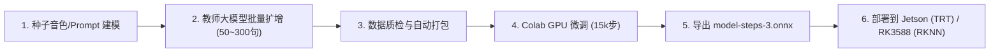

# Matcha-TTS 专属音色定制与端侧微调指南

本文档记录了在 Seeed Local Voice 系统中，基于大模型教师数据扩增与轻量流匹配声学模型（Matcha-TTS）微调定制专属发音人的端到端工程流水线与标准操作规程。

---

## 一、工程资产布局

相关工具与资产已固化在工程中以下位置：

| 资产路径 | 职责定位 | 说明 |
| :--- | :--- | :--- |
| **`tools/voice_pipeline/`** | **通用工具库** | 包含语料批量生成、数据清洗、Colab GPU 训练与 ONNX 导出的完整工具集。 |
| `tools/voice_pipeline/config.template.yaml` | 通用配置模板 | 解耦 API 凭据、服务端点、语料配置与算力后端。 |
| `tools/voice_pipeline/pipeline.py` | 统一驱动 CLI | 支持 `synthesize`、`prepare`、`train`、`all` 动作调度。 |
| `tools/voice_pipeline/batch_synthesize.py` | 语料批量生成 | 多进程隔离架构，杜绝 SDK 连接死锁，支持断点续传。 |
| `tools/voice_pipeline/prepare_dataset.py` | 数据工程与划分 | 校验音频时长、划分训练/验证集并打包为 `dataset.tar.gz`。 |
| `tools/voice_pipeline/colab_runner/train_and_export.py` | 声学模型微调引擎 | 在 GPU 上执行 OT-CFM 微调并导出标准 `model-steps-3.onnx`。 |
| `tools/voice_pipeline/remote_colab_train.sh` | 自动化生命周期调度 | 一键完成“租用 Colab $\rightarrow$ 传输 $\rightarrow$ 训练 $\rightarrow$ 回传 $\rightarrow$ 释放实例”。 |
| **`voices/zgl_matcha_pipeline/`** | **样例发音人资产 (张国立)** | 包含训练生成的 50 条 WAV 语料及导出的 `model-steps-3.onnx`。 |

---

## 二、端到端 4 阶段标准化流程



### 1. 配置与语料生成
复制配置模板并填写目标发音人参数：
```bash
cp tools/voice_pipeline/config.template.yaml my_voice.yaml
python3 tools/voice_pipeline/pipeline.py synthesize --config my_voice.yaml
```

### 2. 数据质检与打包
```bash
python3 tools/voice_pipeline/pipeline.py prepare --config my_voice.yaml
```

### 3. 一键训练与导出
```bash
python3 tools/voice_pipeline/pipeline.py train --config my_voice.yaml
```

---

## 三、时间与成本基准表

以定制 300 句高质量发音平衡语料（约 30 分钟音频）为例：

| 阶段 | 任务内容 | 实际耗时 | 财务成本 | 算力与服务载体 |
| :--- | :--- | :--- | :--- | :--- |
| **1. 素材批量生成** | 300 句语料合成（约 5,400 汉字） | **5 ~ 10 分钟** | **约 0.2 ~ 0.5 元** | 阿里百炼 / MiniMax 云端 API |
| **2. 质检与音素处理** | ASR 回检查错、VAD 截断、提取音素 | **3 ~ 5 分钟** | **0 元** | 本地 CPU 自动运行 |
| **3. 云端微调训练** | 冻结 Encoder，微调 12,000 ~ 15,000 步 | **50 ~ 70 分钟** | **约 1.5 ~ 2 元**（或免费配额） | Colab T4 GPU (16GB) |
| **4. 导出与端侧编译** | 导出 ONNX，编译 Jetson TRT 或 RKNN | **3 ~ 5 分钟** | **0 元** | 本地 / 边缘设备 |
| **全流程总计** | **从零到端侧可运行专属音色** | **约 1.5 ~ 2 小时** | **约 2 ~ 3 元** | — |
