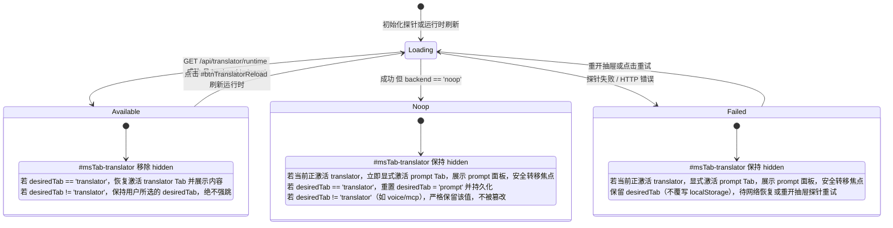

# SenseCraft Local Voice 设置面板 Tab 化与顶部工具栏自适应重构规范 (v2.5)

> **目标**：
> 1. **设置抽屉 Tab 结构化解耦**：解决抽屉（`#modeSettingsPanel`）内 5 大功能块纵向单列堆叠造成的滚动冗长与认知混乱，构建对齐 SenseCraft-UI 设计 Token 的自适应 Tab 选项卡系统。
> 2. **顶部工具栏防遮挡与全视口自适应**：解决工具栏放置 7 个事件过滤复选框（`.filters`）导致中窄视口折行膨胀、甚至将左侧状态灯与设置按钮挤出屏幕发生裁剪遮挡的严重缺陷。
>
> **遵循准则**：`dev-flow`、`taste`（真实优先、变更有界、按使用者心智模型建模、通用优先于 Hack、零破坏性）。

---

## 1. 架构目标与心智模型对齐

### 1.1 现状分析与实测基线数据

可复现测量命令（前置条件：启动预览服务 `uv run --project agent python scripts/preview_dashboard.py --port 18080`；可通过 `CHROME_PATH` 环境变量指定可执行路径，未指定时默认使用系统已下载的 Chromium）：
```bash
uv run --with playwright python scripts/check_toolbar.py
```
真实视口实测数据（Baseline Metrics）：
- **1920px 视口**：`#toolbar` 总宽 1920px，高度 54px。`.tb-left`（含 `.filters` 宽 562.1px）占据 865.8px，`.tb-right` 占据 1022.2px。
- **1440px / 1280px / 1024px 视口**：由于单行总宽需求（~1450px）超出视口可用宽度，`.tb-right` 强制折行，工具栏高度突增至 99px；在缩放或内嵌容器下，`.tb-left` 发生左侧溢出，导致用户截屏中“状态灯、模式选择、设置按钮被左边缘裁剪（首字符被切为‘助手回复’的‘复’）”。
- **375px 移动端视口**：工具栏高度堆叠至 208px，占用超过 1/4 屏幕高度。

**根因归因**：
- 这 7 个复选框（`input[data-f]`）**仅用于过滤“事件流”（#tab-events）中的 WebSocket 日志**，与“对话”（#tab-chat）和“LLM 上下文”（#tab-history）完全无关。
- 将专属过滤逻辑常驻在全局顶部导航，是导致工具栏空间耗尽与遮挡的单一直接根因。

### 1.2 解决方案

1. **事件过滤收敛至事件流面板**：
   - 将 `<div class="filters" id="filters">` 从 `#toolbar` 移至 `#tab-events` 面板专属的 `.events-toolbar` 中（对齐 `#tab-history` 已有的 `.history-toolbar` 模式）。
   - 全局顶部工具栏 `.tb-left` 仅保留核心上下文控件（`#statePill`、`#modeWrap`、`#modeSettingsBtn`），总宽收敛至 ~250px，设置 `flex-shrink: 0`。
   - 工具栏响应式布局：
     - `>= 900px` 桌面端：`#toolbar`、`.tb-left`、`.tb-right` 统一设置 `flex-wrap: nowrap`，单行高度稳定在 52px，无论是否展示 pipeline 控制按钮，均不发生折行与裁剪。
     - `< 900px` 移动/窄屏端：清晰折为两层（上层状态与模式设置，下层操作按钮与发送框），各控件自适应伸缩，彻底杜绝横向滚动溢出。
     - `<= 480px / 375px` 极小屏：保留全部功能与 `#btnMenu`，通过双行流式网格排布，所有控件 100% 可达。
2. **设置抽屉解耦为 4 大领域 Tab**：
   - `prompt`（💬 提示词与模型）：Prompt 与高级参数；
   - `voice`（🎙 声音与交互）：发音人音色卡片与语音唤醒交互卡片；
   - `mcp`（🔌 MCP 服务）：MCP 服务清单、状态、连通测试与待生效重启红点；
   - `translator`（🌐 翻译设置）：翻译源/目标语言及后端状态（探测可用前平滑保持或恢复，未启用/noop 时隐藏）。

---

## 2. 变更范围与硬性约束清单 (Manifest & Contracts)

### 2.1 变更文件白名单 (File Manifest)
严格限定在以下 3 个静态前端文件，**严禁改动任何 Python 后端代码或 API 路由**：
1. `agent/ovs_agent/plugins/static/dashboard.html`（结构范围：[dashboard.html:10-53](file:///home/harvest/project/seeed-local-voice/agent/ovs_agent/plugins/static/dashboard.html#L10-L53) 工具栏，[dashboard.html:64-67](file:///home/harvest/project/seeed-local-voice/agent/ovs_agent/plugins/static/dashboard.html#L64-L67) 事件流工具栏，[dashboard.html:146-311](file:///home/harvest/project/seeed-local-voice/agent/ovs_agent/plugins/static/dashboard.html#L146-L311) 设置抽屉）
2. `agent/ovs_agent/plugins/static/dashboard.css`（样式范围：[dashboard.css:66-180](file:///home/harvest/project/seeed-local-voice/agent/ovs_agent/plugins/static/dashboard.css#L66-L180) 工具栏样式，[dashboard.css:750-805](file:///home/harvest/project/seeed-local-voice/agent/ovs_agent/plugins/static/dashboard.css#L750-L805) Tab 样式）
3. `agent/ovs_agent/plugins/static/dashboard.js`（逻辑范围：[dashboard.js:203-280](file:///home/harvest/project/seeed-local-voice/agent/ovs_agent/plugins/static/dashboard.js#L203-L280) Tab 状态机与生命周期，[dashboard.js:2078-2083](file:///home/harvest/project/seeed-local-voice/agent/ovs_agent/plugins/static/dashboard.js#L2078-L2083) MCP 红点联动，[dashboard.js:950-955](file:///home/harvest/project/seeed-local-voice/agent/ovs_agent/plugins/static/dashboard.js#L950-L955) 过滤监听）

### 2.2 核心 DOM 契约与 17 个受保护 ID（100% 存在且全局唯一）
必须严格保留并保证在整个 DOM 树中唯一：
1. `setPipelineMode`
2. `setSleepTimeout`
3. `setStopWords`
4. `setExitWords`
5. `setWakeReply`
6. `setExitReply`
7. `btnAgentSettingsSave`
8. `btnAgentSettingsReload`
9. `wwPhrases`
10. `btnWwSave`
11. `btnWwValidate`
12. `btnWwTone`
13. `wwBadge`
14. `wwHint`
15. `btnRestartAgent`
16. `btnRestartAgentMenu`
17. `modeRestartTag`

同时完整保留并维持原有绑定行为：
- **抽屉与头部契约**：
  - 容器：`#modeSettingsPanel`（class 必须包含 `mode-settings-panel hidden`）
  - 模式显示：`#msMode`（严格保持现有 ID）
  - 关闭按钮：`#msClose`（严格保持现有 ID，关闭抽屉并保留 focus 归还逻辑）
- **Prompt 配置**：
  - `#msSystemPrompt`, `#msSystemPromptDefault`, `#msAdvancedToggle`, `#msAdvancedBody`, `#msTemperature`, `#msMaxHistory`, `#msBargeIn`, `#msSave`, `#msReset`
- **TTS 音色**：
  - `#ttsVoiceCard`, `#voiceSelect`, `#btnVoiceReload`, `#voiceModel`, `#voiceCount`, `#btnVoiceClone`, `#voiceHint`
- **MCP 服务**：
  - `#mcpCard`, `#mcpCount`, `#btnMcpRefresh`, `#btnMcpAdd`, `#mcpPendingBar`, `#btnMcpRestartNow`, `#mcpNotice`, `#mcpList`
  - 模态框全套 ID：`#mcpModal`, `#mcpModalTitle`, `#mcpModalClose`, `#mcpForm`, `#mcpName`, `#mcpTransport`, `#mcpCommand`, `#mcpArgs`, `#mcpEnv`, `#mcpUrl`, `#mcpHeaders`, `#btnMcpTest`, `#mcpTestResult`, `#btnMcpSave`, `#btnMcpCancel`
- **翻译卡片**：
  - `#translatorCard`, `#translatorBackendBadge`, `#btnTranslatorToggle`, `#translatorBody`, `#setTranslatorTgtLang`, `#translatorSrcLangText`, `#btnTranslatorSave`, `#btnTranslatorReload`
- **事件过滤容器与 input 契约**：
  - `<div class="filters" id="filters">` 及其内部 7 个带 `data-f` 的 input（`utt`, `tok`, `partial`, `stats`, `state`, `mic`, `error`）。
- **工具栏操作与菜单按钮**：
  - `#btnReconnect`, `#btnRestartMic`, `#btnAbort`, `#sendInput`, `#btnSend`, `#btnMenu`, `#menu`, `#btnClear`, `#btnClearContextMenu`, `#btnPause`, `#btnRestartAgentMenu`

---

## 3. DOM 结构设计 (`dashboard.html`)

### 3.1 顶部工具栏与事件流专属工具栏

```html
<!-- 全局顶部工具栏 -->
<div id="toolbar">
  <div class="tb-left">
    <span id="statePill" class="state-pill state-idle">
      <span class="state-dot"></span><span id="stateText">IDLE</span>
    </span>
    <div id="modeWrap" class="mode-wrap">
      <button id="modeBtn" class="mode-btn" title="切换 App Mode">
        <span id="modeIcon">💬</span>
        <span id="modeLabel">对话</span>
        <span class="caret">▼</span>
      </button>
      <div id="modeMenu" class="mode-menu hidden"></div>
    </div>
    <button id="modeSettingsBtn" class="ctl-btn" title="编辑当前模式的 system prompt / temperature">⚙ 设置</button>
  </div>
  <div class="tb-right">
    <button id="btnWake" class="ctl-btn pipeline-ctl hidden" title="唤醒 agent (从 SLEEPING → IDLE)">唤醒</button>
    <button id="btnSleep" class="ctl-btn pipeline-ctl hidden" title="强制进入 SLEEPING">休眠</button>
    <button id="btnPTT" class="ctl-btn pipeline-ctl hidden" title="按住说话 (Push to Talk)">按住说话</button>
    <span id="pipelineBadge" class="pipeline-badge hidden"></span>
    <button id="btnReconnect" class="ctl-btn" title="重新建立 SLV WebSocket 连接">重连 SLV</button>
    <button id="btnRestartMic" class="ctl-btn" title="重启本机麦克风采集流">重启麦克风</button>
    <button id="btnAbort" class="ctl-btn" title="立刻中止当前 TTS 播放">中止 TTS</button>
    <input id="sendInput" type="text" placeholder="跳过麦克风直接发文字给助手…" />
    <button id="btnSend" class="ctl-btn primary">发送</button>
    <button id="btnMenu" class="icon-btn" title="更多">⋮</button>
    <div id="menu" class="menu hidden">
      <button id="btnClear">清空日志</button>
      <button id="btnClearContextMenu">清空上下文</button>
      <button id="btnPause">暂停</button>
      <button id="btnRestartAgentMenu" class="danger">重启 Agent</button>
    </div>
  </div>
</div>

<!-- 事件流 Tab 内的专属过滤工具栏 -->
<div class="tab-panel" id="tab-events">
  <div class="events-toolbar">
    <span class="events-toolbar-title">事件过滤:</span>
    <div class="filters" id="filters">
      <label title="用户完整语句"><input type="checkbox" data-f="utt" checked /> 用户语句</label>
      <label title="助手 LLM token 流"><input type="checkbox" data-f="tok" checked /> 助手回复</label>
      <label title="ASR 中间识别（每 100ms 一次）"><input type="checkbox" data-f="partial" /> 识别中</label>
      <label title="WS 连接 / 队列健康指标"><input type="checkbox" data-f="stats" /> 连接状态</label>
      <label title="ConvState 切换 idle/listening/thinking/speaking"><input type="checkbox" data-f="state" /> 状态切换</label>
      <label title="麦克风音量波形（10fps 噪声）"><input type="checkbox" data-f="mic" /> 麦克风电平</label>
      <label title="错误"><input type="checkbox" data-f="error" checked /> 错误</label>
    </div>
  </div>
  <div id="events" class="event-stream"></div>
</div>
```

### 3.2 设置抽屉 Tab 结构

```html
<div id="modeSettingsPanel" class="mode-settings-panel hidden">
  <div class="ms-header" id="modeSettingsHeader">
    <span>当前模式: <span id="msMode">–</span></span>
    <button id="msClose" class="icon-btn" title="关闭">×</button>
  </div>
  
  <div class="ms-tabs" id="msTabs" role="tablist" aria-label="设置分类">
    <button type="button" class="ms-tab" role="tab" id="msTab-prompt" data-tab="prompt" aria-controls="msTabPanel-prompt" aria-selected="true" tabindex="0">💬 提示词与模型</button>
    <button type="button" class="ms-tab" role="tab" id="msTab-voice" data-tab="voice" aria-controls="msTabPanel-voice" aria-selected="false" tabindex="-1">🎙 声音与交互</button>
    <button type="button" class="ms-tab" role="tab" id="msTab-mcp" data-tab="mcp" aria-controls="msTabPanel-mcp" aria-selected="false" tabindex="-1">
      🔌 MCP 服务
      <span id="msTabPendingBadge-mcp" class="tab-badge-dot hidden" title="有待生效的配置变更"></span>
    </button>
    <button type="button" class="ms-tab" role="tab" id="msTab-translator" data-tab="translator" aria-controls="msTabPanel-translator" aria-selected="false" tabindex="-1" hidden>🌐 翻译设置</button>
  </div>

  <div class="ms-body" id="msBody">
    <section class="ms-tab-panel" role="tabpanel" id="msTabPanel-prompt" aria-labelledby="msTab-prompt">
      <label class="ms-label">System prompt</label>
      <textarea id="msSystemPrompt" rows="6" placeholder="(继承类默认)"></textarea>
      <div class="ms-default muted small">默认: <span id="msSystemPromptDefault">–</span></div>

      <button id="msAdvancedToggle" class="advanced-toggle ctl-btn">▾ 高级</button>
      <div id="msAdvancedBody" class="hidden">
        <label class="ms-label">Temperature</label>
        <input id="msTemperature" type="number" step="0.1" min="0" max="2" placeholder="(继承)" />
        <label class="ms-label">Max history</label>
        <input id="msMaxHistory" type="number" step="1" min="0" placeholder="(继承)" />
        <label class="ms-label">Barge-in</label>
        <select id="msBargeIn">
          <option value="">(继承)</option>
          <option value="true">true (允许打断)</option>
          <option value="false">false (禁止打断)</option>
        </select>
      </div>

      <div class="ms-actions">
        <button id="msSave" class="ctl-btn primary">保存</button>
        <button id="msReset" class="ctl-btn">恢复默认</button>
      </div>
    </section>

    <section class="ms-tab-panel" role="tabpanel" id="msTabPanel-voice" aria-labelledby="msTab-voice" hidden>
      <!-- #ttsVoiceCard -->
      <!-- #agentSettingsCard -->
    </section>

    <section class="ms-tab-panel" role="tabpanel" id="msTabPanel-mcp" aria-labelledby="msTab-mcp" hidden>
      <!-- #mcpCard -->
    </section>

    <section class="ms-tab-panel" role="tabpanel" id="msTabPanel-translator" aria-labelledby="msTab-translator" hidden>
      <!-- #translatorCard -->
    </section>
  </div>
</div>
```

---

## 4. 样式规范与自适应响应式 (`dashboard.css`)

### 4.1 顶部工具栏确定性断点规则
严格统一断点阈值，消除样式覆盖冲突，保留全功能入口：

```css
/* ── Toolbar 基础桌面布局 (>= 900px) ─────────────────────────────────── */
#toolbar {
  display: flex;
  justify-content: space-between;
  align-items: center;
  gap: 12px 16px;
  flex-wrap: nowrap; /* 桌面端单行 */
  padding: 10px 16px;
  background: var(--panel);
  border-bottom: 1px solid var(--border);
  position: relative;
  z-index: 10;
  min-height: 52px;
}

.tb-left {
  display: flex;
  align-items: center;
  gap: 10px;
  flex: 0 0 auto; /* 保证左侧状态灯和设置按钮永远不被挤压 */
  flex-wrap: nowrap;
  min-width: 0;
}

.tb-right {
  display: flex;
  align-items: center;
  gap: 8px;
  flex: 1 1 auto;
  justify-content: flex-end;
  flex-wrap: nowrap; /* 桌面端不折行 */
  min-width: 0;
}

#sendInput {
  flex: 1 1 180px;
  min-width: 120px;
  max-width: 320px;
}

.menu {
  position: absolute;
  right: 16px;
  top: 48px;
  background: #202737;
  border-radius: var(--radius);
  box-shadow: var(--shadow);
  padding: 4px;
  display: flex;
  flex-direction: column;
  gap: 2px;
  z-index: 50;
}

/* ── 窄屏与平板断点 (<= 899px) ─────────────────────────────────────── */
@media (max-width: 899px) {
  #toolbar {
    flex-wrap: wrap;
    row-gap: 8px;
    padding: 8px 12px;
  }
  .tb-left {
    width: 100%;
    justify-content: flex-start;
    flex-wrap: wrap;
  }
  .tb-right {
    width: 100%;
    justify-content: flex-end;
    flex-wrap: wrap;
    gap: 6px;
  }
  #sendInput {
    flex: 1 1 140px;
    max-width: none;
  }
  .menu {
    right: 12px;
    top: 86px;
  }
}

/* ── 移动端极限断点 (<= 480px / 375px) ─────────────────────────────── */
/* 必须完整保留 #btnMenu，通过双行流式弹性布局保证 100% 控件可达 */
@media (max-width: 480px) {
  #toolbar {
    padding: 8px 10px;
    row-gap: 6px;
  }
  .tb-left {
    gap: 6px;
  }
  .tb-right {
    display: flex;
    flex-wrap: wrap;
    gap: 6px;
    width: 100%;
  }
  .tb-right .ctl-btn,
  .tb-right .icon-btn {
    padding: 4px 8px;
    font-size: 11px;
    flex: 0 0 auto;
  }
  #sendInput {
    flex: 1 1 160px;
    min-width: 120px;
    font-size: 12px;
    padding: 4px 8px;
  }
  #btnSend {
    flex: 0 0 auto;
  }
  #btnMenu {
    display: inline-flex !important; /* 强制保留更多菜单触发器 */
    padding: 4px 8px;
  }
  .menu {
    right: 8px;
    top: auto;
    bottom: auto;
  }
}

/* 事件流专属过滤栏 */
.events-toolbar {
  display: flex;
  align-items: center;
  gap: 10px;
  padding: 8px 12px;
  margin-bottom: 8px;
  background: var(--panel);
  border: 1px solid var(--border);
  border-radius: var(--sc-radius-base);
  flex-wrap: wrap;
}
.events-toolbar-title {
  font-size: 12px;
  font-weight: 600;
  color: var(--muted);
  white-space: nowrap;
}
```

### 4.2 设置抽屉 Tab 规范
```css
#modeSettingsPanel {
  height: min(84vh, 720px);
}

.mode-settings-panel .ms-tabs {
  position: sticky;
  top: 0;
  z-index: 2;
  flex: 0 0 auto;
  display: flex;
  gap: 4px;
  padding: 0 16px;
  background: #131b2e;
  border-bottom: 1px solid var(--border);
  overflow-x: auto;
  overflow-y: hidden;
  overscroll-behavior-x: contain;
  -webkit-overflow-scrolling: touch;
  scrollbar-width: none;
}
.mode-settings-panel .ms-tabs::-webkit-scrollbar { display: none; }

.ms-tab {
  flex: 0 0 auto;
  position: relative;
  padding: 11px 14px 10px;
  border: none;
  background: transparent;
  color: #8b949e;
  font: inherit;
  font-size: 13px;
  font-weight: 500;
  white-space: nowrap;
  cursor: pointer;
  border-radius: var(--sc-radius-sm) var(--sc-radius-sm) 0 0;
  transition: color 0.15s ease, background-color 0.15s ease;
}
.ms-tab:hover {
  color: #f0f4fc;
  background: rgba(240,244,252,0.04);
}
.ms-tab[aria-selected="true"] {
  color: #f0f4fc;
  font-weight: 600;
}
.ms-tab::after {
  content: "";
  position: absolute;
  left: 10px;
  right: 10px;
  bottom: 0;
  height: 2px;
  border-radius: 2px 2px 0 0;
  background: transparent;
  transition: background-color 0.15s ease;
}
.ms-tab[aria-selected="true"]::after {
  background: var(--accent);
}
.ms-tab:focus-visible {
  outline: 2px solid var(--ring);
  outline-offset: -2px;
}
.ms-tab[hidden] { display: none; }

.tab-badge-dot {
  display: inline-block;
  width: 7px;
  height: 7px;
  border-radius: 50%;
  background: var(--warn, #f6a623);
  margin-left: 4px;
  vertical-align: middle;
}
.tab-badge-dot.hidden { display: none; }

#modeSettingsPanel .ms-body {
  overflow-x: hidden;
  overflow-y: auto;
  background: #0f1419;
  flex: 1 1 auto;
  min-height: 0;
  padding: 16px;
  border-radius: 0 0 var(--sc-radius-lg) var(--sc-radius-lg);
}
.ms-tab-panel {
  display: flex;
  flex-direction: column;
  gap: 12px;
  min-width: 0;
}
.ms-tab-panel[hidden] { display: none !important; }
```

---

## 5. 交互状态机与翻译生命周期设计 (`dashboard.js`)

### 5.1 Tab 状态机与持久化契约
- 存储键名：`ovs.dashboard.settingsTab`。
- **状态验证机制**：
  - 初始化或切换时，验证目标 Tab 是否合法且属于当前可见集合（`!tab.hidden`）。
  - 若目标非法或不可见，**回退至 `'prompt'`**，并确保有且仅有一个可见 Tab 处于激活状态（`aria-selected="true"`，`tabindex="0"`，对应 Panel `hidden=false`）。其余可见 Tab 统一置为 `aria-selected="false"`，`tabindex="-1"`，Panel `hidden=true`。
- **WAI-ARIA Roving Tabindex 键盘导航**：
  - 聚焦在 Tab 时，`ArrowRight` / `ArrowLeft` / `Home` / `End` 仅在当前**可见（!hidden）**的 Tab 集合中循环轮转。
  - 轮转后自动激活该 Tab，并执行 `tab.focus()`。
  - 按 `Tab` / `Shift+Tab` 时顺畅离开 Tab 栏，进入下方 Panel 内部控件或返回抽屉关闭按钮。

### 5.2 统一目标 Tab 意图模型与翻译生命周期 (Codex Major 彻底闭环)
为彻底杜绝“初始加载”、“瞬时网络抖动”、“运行时手动刷新”以及“用户中途切换”等多种并发时序下的状态覆盖与悬挂焦点漏洞，引入统一且直观的**目标意图状态模型**：

```javascript
// 核心状态变量：
// desiredTab: 用户最终期望停留在哪个 Tab（初始化读取自 localStorage，默认 "prompt"）
let desiredTab = "prompt";
try { desiredTab = localStorage.getItem(MS_TAB_KEY) || "prompt"; } catch (_) {}

// 任何时候用户显式点击或按键选择某个 Tab（T）时：
function onUserSelectTab(targetTab) {
  desiredTab = targetTab;
  try { localStorage.setItem(MS_TAB_KEY, desiredTab); } catch (_) {}
  activateSettingsTab(targetTab);
}
```



- **生命周期状态迁移与意图保护精准行为**：
  1. **初始加载阶段**：
     - 若 `desiredTab === "translator"`：由于此时探针尚在 `loading` 中且 `#msTab-translator` 处于 `hidden`，界面首先激活并渲染默认的 `'prompt'` Tab（保障有且仅有一个可见 Tab 拥有 `aria-selected="true"` 和 `tabindex="0"`），但在内存与持久化中保持 `desiredTab = "translator"`。
     - 若 `desiredTab === "voice"` 或 `"mcp"`：界面直接激活并渲染对应面板。
  2. **用户主动交互**：
     - 用户在任何时刻点击任意 Tab（如在探针挂起时主动点击了 `voice`，或点击了 `prompt`），`onUserSelectTab` 立即将 `desiredTab` 赋值为用户新选的 Tab 并存入 `localStorage`。
  3. **探针返回结果判定（初始探测 或 运行时重新加载）**：
     - **情况 A：探针返回 `available`（后端非 noop）**：
       - 解除 `#msTab-translator` 的 `hidden` 属性。
       - **若 `desiredTab === "translator"`**：表明用户无论是在初始启动、还是在经历失败重试后，其最终意图都是停留在翻译面板，此时**自动平滑激活 `'translator'` Tab**并呈现其面板内容。
       - **若 `desiredTab !== "translator"`**（例如启动时存的是 `voice`/`mcp`，或用户在加载期间主动选了其他 Tab）：**严格保持当前激活的 `desiredTab`，绝不发生非预期的自动跳转**。
     - **情况 B：探针返回 `noop`（空翻译插件）**：
       - `#msTab-translator` 保持/设为 `hidden`。
       - **UI 降级与焦点安全转移**：若当前正处于 `translator` Tab 激活状态（例如在抽屉内点击刷新运行时，后端返回了 noop），**必须立即执行 `activateSettingsTab('prompt')`**：
         - 激活 `#msTab-prompt`（`aria-selected="true"`, `tabindex="0"`）；
         - 隐藏 `#msTabPanel-translator`（`hidden=true`），展示 `#msTabPanel-prompt`（`hidden=false`）；
         - 将焦点安全转移至 `#msTab-prompt`（或抽屉关闭按钮 `#msClose`），绝不产生游离焦点或停留在隐藏的 Tab 上。
       - **持久化契约**：
         - **若 `desiredTab === "translator"`**：因为当前系统确定不支持翻译功能，将 `desiredTab` 重置为 `'prompt'` 并覆写回 `localStorage`。
         - **若 `desiredTab !== "translator"`（如 `voice` 或 `mcp`）**：**严格保留用户的存储值与激活状态，绝不篡改覆写为 `'prompt'`**。
     - **情况 C：探针返回 `failed`（网络中断或异常）**：
       - `#msTab-translator` 置为 `hidden`。
       - **UI 降级与焦点安全转移**：若当前正显示 translator 面板（如在已打开的抽屉中点击刷新失败），**同样立即显式执行 `activateSettingsTab('prompt')`**，展示 prompt 面板，并将焦点安全转移至 `#msTab-prompt` 或抽屉关闭按钮。
       - **持久化契约**：**严禁覆写 `localStorage`**！保留 `desiredTab = "translator"` 记录，下一次重开抽屉或网络恢复后探测成功，立即自动恢复呈现翻译面板。
  4. **重试探针入口**：
     - 每次打开设置抽屉（`#modeSettingsBtn` 被点击）时，若 translator 尚未加载或之前处于 failed 状态，自动重新发起探针探测。
     - 点击 `#btnTranslatorReload` 重新加载翻译运行时。

### 5.3 MCP 待生效红点联动
- 在 `renderMcpPending()` 内部，同时更新：
  1. `#mcpPendingBar.classList.toggle("hidden", !mcpState.pending)`
  2. `$("msTabPendingBadge-mcp").classList.toggle("hidden", !mcpState.pending)`
- 确保用户在切换到其他 Tab 时，Tab 按钮上的红点直观提示重启需求。

---

## 6. 验证与验收矩阵 (Verification Matrix) (Codex 收敛闭环)

| 编号 | 检查项 | 验证方式与断言标准 |
|---|---|---|
| **V1** | **核心 DOM 保护与唯一性** | 检查 17 个受保护 ID + `msMode` + `msClose` + `btnMcpRefresh` + `setTranslatorTgtLang` + `#btnMenu`。断言每一个 ID 在 DOM 树中**存在且数量严格等于 1**。 |
| **V2** | **抽屉展开/关闭与焦点归还** | 点击 `#modeSettingsBtn`，断言 `#modeSettingsPanel` 移除 `hidden`；点击 `#msClose` 或按下 `Escape`，断言抽屉恢复 `hidden` 且焦点正确归还给 `#modeSettingsBtn`。 |
| **V3** | **全视口边界、重叠与可达性检查** | 在 **1920px、1440px、1280px、1024px、900px（临界）、899px（临界）、768px、375px** 八个视口下运行自动化检查：<br>1. `#toolbar` 内部所有可见控件（含 `#statePill`、`#modeWrap`、`#modeSettingsBtn`、`#btnMenu` 等）的 `getBoundingClientRect()` 坐标均处于 `[0, clientWidth]` 范围内，无裁切、无互相重叠；<br>2. 整个文档 `doc.scrollWidth === doc.clientWidth`（横向溢出严格为 0）；<br>3. 桌面端（>=900px）无论 pipeline 控制按钮显示与否，工具栏高度严格 `<= 54px`（单行）；<br>4. 在移动端 375px 下，点击 `#btnMenu` 断言 `#menu` 展开且内部 4 个菜单项完全位于视口内并可点击。 |
| **V4** | **Tab 状态机与 Roving Tabindex 唯一性** | 1. 任何时刻 `document.querySelectorAll(".ms-tab[aria-selected='true']").length === 1`；<br>2. 激活项 `tabindex="0"`，其余所有可见项 `tabindex="-1"`；<br>3. 激活项对应的 Panel 处于可见状态（`hidden=false`），其余所有 Panel 处于 `hidden=true`。 |
| **V5** | **键盘无障碍导航 (Left/Right/Home/End)** | 聚焦在 Tab 按钮时，按 `ArrowRight` / `ArrowLeft` / `Home` / `End` 仅在可见 Tab 之间循环切换焦点并同步激活对应面板；不可见的 `translator` 被自动跳过。 |
| **V6** | **事件过滤功能 100% 保持** | 在 `#tab-events` 内操作 7 个过滤复选框，断言 WebSocket 事件流对应类型的过滤行为正常执行，且对 `#tab-chat` 无任何负面副作用。 |
| **V7** | **翻译后端生命周期与意图模型闭环** | 1. **初始探针恢复**：初始 `desiredTab = 'translator'`，探针成功返回 available 时，自动平滑激活并呈现 translator Tab；<br>2. **用户意图绝对保护**：探针挂起期间用户点击 `voice` Tab，探针成功后断言**保持停留在 `voice`**，不被篡改强跳；<br>3. **探针失败保持意图**：探针失败时断言 `localStorage` 保持原本的 `desiredTab`，再次打开抽屉重试成功后恢复呈现；<br>4. **noop 保护非翻译配置**：启动存储为 `voice` 或 `mcp` 时探针返回 `noop`，断言其存储值与激活状态完全保持，绝不被篡改覆写为 `prompt`；<br>5. **刷新失败降级与重试恢复**：在 translator Tab 中点击刷新发生失败，断言 `#msTab-translator` 隐藏，界面平滑降级至 `prompt` 面板且焦点安全转移至 prompt Tab 或关闭按钮，再次探测成功后平滑恢复展示 translator 面板；<br>6. **noop 降级与焦点安全转移**：在 translator Tab 激活状态下刷新返回 noop，断言 `#msTab-translator` 隐藏，立即激活 prompt Tab（`aria-selected=true`, `tabindex=0`），prompt 面板可见（`hidden=false`），translator 面板隐藏，焦点安全转移至 prompt Tab 按钮或抽屉关闭按钮，且持久化 intent 被重置为 `'prompt'`。 |
| **V8** | **MCP 待生效红点联动** | 设置 `mcpState.pending = true` 时，`#msTabPendingBadge-mcp` 显示红点；重启或重置为 false 时，红点即刻隐藏。 |
| **V9** | **控制台健康监控** | 监听 `pageerror` 与 `console.error`。在抽屉多轮操作、Tab 轮转与视口切换全流程中，**两项错误捕获计数均严格为 0**。 |
